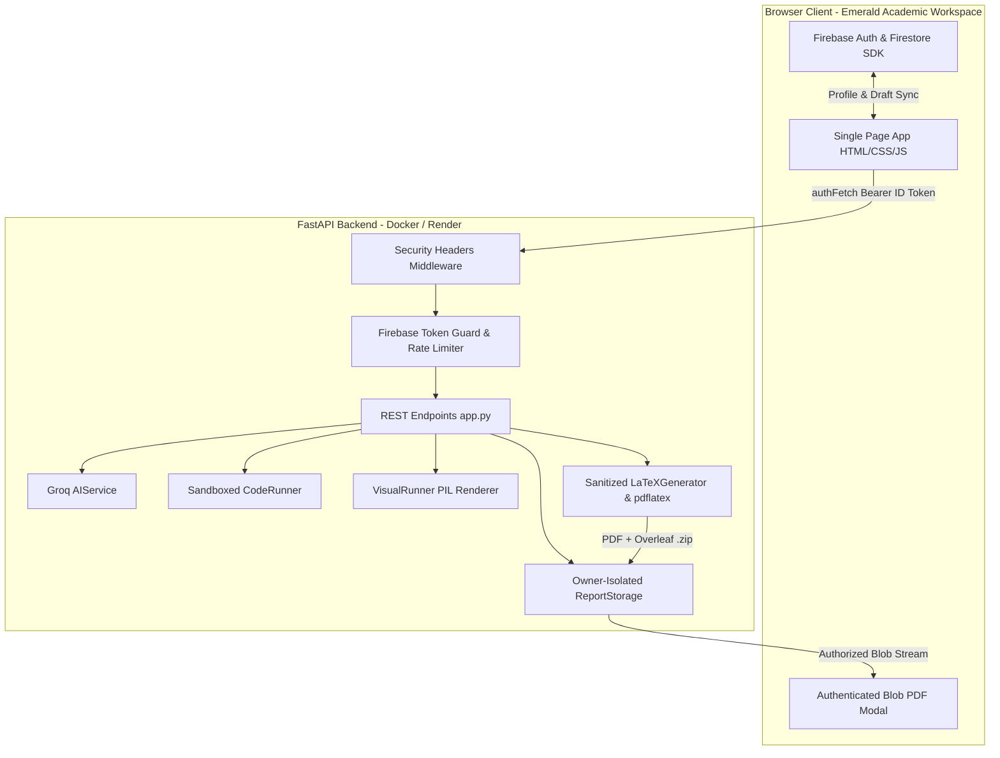

<p align="center">
  
</p>

<h1 align="center">Lab Report Lagbe? — AI Academic Programming Lab Report Workspace</h1>

<p align="center">
  <a href="https://lab-report-lagbe.onrender.com"></a>
  
  
  
  
  
  
  
</p>

<p align="center">
  An AI-powered, full-stack academic workspace for generating, compiling, and managing publication-grade programming lab reports. Converts lab manuals, problem statements, and verified code executions into institutional LaTeX PDFs and Overleaf-ready archives with Firebase authentication and cloud profile sync.
</p>

> [!IMPORTANT]
> **Live Production Deployment:**
> - **Web Workspace & API:** [https://lab-report-lagbe.onrender.com](https://lab-report-lagbe.onrender.com)
> - **Service Health Endpoint:** [https://lab-report-lagbe.onrender.com/api/health](https://lab-report-lagbe.onrender.com/api/health)
> - **Source Code Repository:** [https://github.com/Masud744/Lab-Report-Lagbe](https://github.com/Masud744/Lab-Report-Lagbe)

---

## Table of Contents

1. [Overview](#1-overview)
2. [Live Deployments](#2-live-deployments)
3. [Key Features](#3-key-features)
4. [System Architecture](#4-system-architecture)
5. [Security Architecture & Hardening](#5-security-architecture--hardening)
6. [Technology Stack](#6-technology-stack)
7. [API Reference](#7-api-reference)
8. [Project Structure](#8-project-structure)
9. [Installation & Local Setup](#9-installation--local-setup)
10. [Docker & Cloud Deployment (Render)](#10-docker--cloud-deployment-render)
11. [Author](#11-author)
12. [License](#12-license)

---

## 1. Overview

Formatting university programming lab reports manually across code editors, terminal screenshots, figure grids, and LaTeX templates takes significant effort every week. **Lab Report Lagbe?** automates the entire workflow inside a unified web workspace:

- Upload a lab manual PDF, problem screenshot, or plain text brief to auto-populate course details, tasks, and requirements.
- Write and run code directly inside the browser Code Workspace (with headless Matplotlib chart capture and automatic error self-healing) or supply custom source code and output screenshots.
- Inspect and edit AI-generated Problem Overview, Methodology points, Code, Execution Output, Figure Captions, and Result & Discussion in the **Review & Edit Studio** before compilation.
- Export publication-grade PDFs with an institutional TikZ cover page alongside an Overleaf-ready `_latex.zip` bundle (`main.tex`, crest logo, and figures).

---

## 2. Live Deployments

| Component | Platform | URL / Details |
| :--- | :--- | :--- |
| **Web Application (SPA + FastAPI)** | Render (Docker Web Service) | [https://lab-report-lagbe.onrender.com](https://lab-report-lagbe.onrender.com) |
| **Health & Runtime Probe** | Render | [https://lab-report-lagbe.onrender.com/api/health](https://lab-report-lagbe.onrender.com/api/health) |
| **Authentication & Cloud Sync** | Firebase Auth & Firestore | Google OAuth, Verified Email/Password, Profile & Draft Sync |
| **Repository** | GitHub | [https://github.com/Masud744/Lab-Report-Lagbe](https://github.com/Masud744/Lab-Report-Lagbe) |

---

## 3. Key Features

- **Academic Workspace Dashboard:** Live KPI counters, recent reports table, built-in authenticated PDF preview modal, interactive calendar, quick-start lab templates, activity feed, and `Ctrl+K` global search.
- **Lab Sheet Auto-Fill (`/api/parse-labsheet`):** Extracts course code, course title, lab number, language, tasks, and requirements from PDFs, raster screenshots (PNG/JPG/WEBP), or text files.
- **22 Programming Languages:** Supports Python, C++, C, Java, Dart, JavaScript, TypeScript, SQL, Go, Rust, Kotlin, C#, PHP, Ruby, Swift, R, Bash, MATLAB/Octave, Arduino, Lua, Perl, and Scala.
- **Interactive Code Workspace (`/api/execute`):** Executes code via sandboxed local runtimes (Python/Matplotlib, C, C++, Java, Dart, JavaScript, Bash when enabled), Piston/Judge0, or Groq AI simulation fallback.
- **Self-Healing Code Pipeline:** Captures compiler or runtime errors during execution, sends diagnostics back to Groq LLM to repair the program, and re-runs verification.
- **Review & Edit Studio (`/api/prepare` + `/api/compile`):** Two-stage pipeline letting users inspect and refine every section and figure caption before final LaTeX compilation.
- **Publication-Grade LaTeX & Overleaf Export:** Generates dual-column listings for longer files, 2x2 screenshot figure grids, custom or default UFTB institutional crest cover pages, compiled PDFs, and Overleaf `.zip` archives.
- **Smart Auto-Visualizations:** Automatically generates 4-angle 3D wireframe renders for OpenGL cuboid tasks and 2D pixel grid diagrams for DDA/Bresenham/Midpoint raster tasks when screenshots are omitted.
- **Firebase Auth & Cloud Profile Sync:** Supports Google Sign-In and email/password registration with email verification enforcement, student profile persistence in Firestore, and guest soft-wall prompts before report generation or download.

---

## 4. System Architecture



---

## 5. Security Architecture & Hardening

- **Cryptographic Token Verification (`services/auth_guard.py`):** Verifies Firebase ID tokens against Google public certificates (`google-auth`) on protected endpoints (`/api/generate`, `/api/compile`, `/api/reports/{id}/file`, `/api/reports/{id}/latex`, `DELETE /api/reports/{id}`), and blocks unverified email/password accounts with HTTP `403`.
- **Report Ownership & Firestore Rules (`services/storage.py`, `firestore.rules`):** Enforces server-side `owner_uid` isolation (`_assert_report_owner`) against IDOR across report retrieval, LaTeX download, and deletion, backed by strict owner-only Firestore rules (`isOwner(userId)`, `hasOnly()`, field size limits, default deny).
- **LaTeX Injection & File Read Prevention (`services/latex_generator.py`):** Compiles with `pdflatex -no-shell-escape` and `openin_any=p`/`openout_any=p`, validates `github_link` via `_sanitize_github_url()`, restricts image decoding to raster formats (`_decode_safe_image`), neutralizes `\end{lstlisting}` breakouts, filters unsafe TeX primitives from captions, and confines output paths via `os.path.realpath()`.
- **Sandboxed Code Execution (`services/code_runner.py`):** Scrubs host secrets (`GROQ_API_KEY`, `FIREBASE_*`) via `_build_safe_env()`, runs Python in isolated mode (`python3 -I`) with a non-secret Matplotlib cache, enforces POSIX `rlimit` bounds (`RLIMIT_CPU`, `RLIMIT_CORE=0`, `RLIMIT_FSIZE`, `RLIMIT_NOFILE`), and rejects code over `100,000` characters.
- **Web & Transport Hardening (`app.py`, `static/js/app.js`):** Sets `X-Content-Type-Options: nosniff`, `X-Frame-Options: SAMEORIGIN`, `Referrer-Policy`, `Permissions-Policy`, and `Cache-Control: no-store`; blocks SVG uploads (`400`); applies IP sliding-window rate limiters (`--proxy-headers` aware); sanitizes DOM outputs and streams PDF previews through authenticated `blob:` URLs revoked on modal close.

---

## 6. Technology Stack

| Layer | Technologies |
| :--- | :--- |
| **Backend API** | Python 3.11+, FastAPI, Uvicorn, Pydantic v2, Jinja2, Pillow |
| **AI & Inference** | Groq SDK (`AIService` with automatic fallback models & request-scoped keys) |
| **Document Engine** | TeX Live (`pdflatex`), `listings`, TikZ cover page, `zipfile` Overleaf bundle |
| **Frontend** | Vanilla HTML5, CSS3 (Emerald Academic design system), Modular ES6+ JavaScript |
| **Auth & Cloud Data** | Firebase Authentication, Cloud Firestore (`firestore.rules`), Google Public Cert JWT Check |
| **Deployment** | Docker, `.dockerignore`, `render.yaml` Blueprint on Render.com, Docker Compose + Piston |

---

## 7. API Reference

| Method | Endpoint | Auth Required | Purpose |
| :--- | :--- | :--- | :--- |
| `GET` | `/api/health` | No | Service health and version probe |
| `GET` | `/api/firebase-config` | No | Public Firebase Web SDK configuration |
| `GET` | `/api/dashboard` | Optional | Dashboard stats scoped to signed-in user |
| `GET` | `/api/reports` | Optional | List visible reports for user or legacy samples |
| `GET` | `/api/reports/{id}/file` | Verified User + Owner | Authenticated PDF preview (`inline=1`) or download |
| `GET` | `/api/reports/{id}/latex` | Verified User + Owner | Download Overleaf-ready `_latex.zip` bundle |
| `DELETE` | `/api/reports/{id}` | Verified User + Owner | Delete owned report and generated artifacts |
| `POST` | `/api/parse-labsheet` | Rate Limited | Parse PDF, raster image (no SVG), or text lab sheet |
| `POST` | `/api/execute` | Rate Limited | Execute code in Code Workspace (with AI fallback) |
| `POST` | `/api/prepare` | Rate Limited | Generate editable draft sections, code, and figures |
| `POST` | `/api/compile` | Verified User | Compile reviewed draft into PDF + Overleaf `.zip` |
| `POST` | `/api/generate` | Verified User | End-to-end 1-click prepare and compile pipeline |

---

## 8. Project Structure

```text
Lab Report Generator/
|-- app.py                      # FastAPI server, middleware, validation, REST API routes
|-- services/
|   |-- auth_guard.py           # Firebase ID token verification & sliding-window rate limiter
|   |-- ai_service.py           # Groq API integration, JSON extraction, model fallback
|   |-- code_runner.py          # Isolated local runner, Piston, and Judge0 integration
|   |-- latex_generator.py      # Jinja2 renderer, TeX sanitizer, -no-shell-escape compiler
|   |-- visual_runner.py        # 3D wireframe and 2D raster auto-visualization renderer
|   `-- storage.py              # Thread-safe report metadata, ownership, and activity store
|-- templates/
|   `-- report_template.tex     # Master LaTeX academic report template
|-- static/
|   |-- index.html              # Single-page workspace UI & modals
|   |-- css/style.css           # Application design system styles
|   |-- js/app.js               # Workspace state, authFetch, blob PDF modal, Firestore sync
|   `-- images/                 # App mascot logo, favicon, and institutional crest
|-- firestore.rules             # Strict owner-isolated Cloud Firestore Security Rules
|-- firebase.json               # Firebase project & provider configuration
|-- Dockerfile                  # Multi-stage-clean container with TeX Live & non-root uid 1000
|-- render.yaml                 # Render Blueprint configuration (free Docker web service)
|-- .dockerignore               # Excludes secrets, venv, git metadata, and local outputs
|-- docker-compose.yml          # Local Docker Compose setup with optional Piston container
|-- requirements.txt            # Pinned Python dependencies
|-- .env.example                # Environment variable template
`-- README.md
```

---

## 9. Installation & Local Setup

### Prerequisites

- Python 3.10+
- TeX Live installed locally (`pdflatex`):
  ```bash
  sudo apt update && sudo apt install -y texlive-base texlive-latex-extra texlive-fonts-recommended
  ```
- A Groq API key from [console.groq.com/keys](https://console.groq.com/keys) and a Firebase Web App project.

### Setup & Run

```bash
# Clone the repository
git clone https://github.com/Masud744/Lab-Report-Lagbe.git
cd Lab-Report-Lagbe

# Create and activate virtual environment
python3 -m venv venv
source venv/bin/activate

# Install Python dependencies
pip install -r requirements.txt

# Configure environment variables
cp .env.example .env
# Fill GROQ_API_KEY and FIREBASE_* values in .env

# Run the local development server
uvicorn app:app --reload --host 0.0.0.0 --port 7860
```

Open [http://localhost:7860](http://localhost:7860) in your browser.

---

## 10. Docker & Cloud Deployment (Render)

### Local Docker & Compose

```bash
# Standalone container
docker build -t lab-report-lagbe .
docker run -p 7860:7860 --env-file .env lab-report-lagbe

# Or Docker Compose (app + optional Piston sandbox container)
docker compose up --build
```

### Render.com Free Tier (`render.yaml`)

Both the FastAPI backend and the frontend (`static/`) deploy together from one Docker service configured in [render.yaml](render.yaml):

1. Open [dashboard.render.com](https://dashboard.render.com/) -> **New +** -> **Blueprint** (or **Web Service**) and connect this GitHub repository.
2. Provide the environment values from `.env` when prompted (`ENABLE_LOCAL_RUNNER` defaults to `"false"` on the 512 MB free tier so Code Workspace safely uses `ai-simulated` fallback while preserving RAM for `pdflatex`):
   - `GROQ_API_KEY`
   - `FIREBASE_API_KEY`, `FIREBASE_AUTH_DOMAIN`, `FIREBASE_STORAGE_BUCKET`, `FIREBASE_MESSAGING_SENDER_ID`, `FIREBASE_APP_ID`, `FIREBASE_MEASUREMENT_ID` (`FIREBASE_PROJECT_ID` is preset to `lab-report-lagbe`)
3. Add your live Render hostname (for example `lab-report-lagbe.onrender.com`) under **Firebase Console -> Authentication -> Settings -> Authorized domains** so Google Sign-In works in production.
4. Note: Render free instances spin down after 15 minutes of inactivity (~50-60s cold wake-up) and reset ephemeral container files (`output/`, `data/`), while Firestore user profiles, drafts, and metadata remain persisted.

---

## 11. Author

**Shahriar Alom Masud**  
B.Sc. Engg. in Internet of Things and Robotics Engineering (IRE)  
University of Frontier Technology, Bangladesh (UFTB)  
- **Email:** [shahriar0002@std.uftb.ac.bd](mailto:shahriar0002@std.uftb.ac.bd)  
- **Personal Email:** [masud.nil74@gmail.com](mailto:masud.nil74@gmail.com)  
- **LinkedIn:** [https://www.linkedin.com/in/shahriar-alom-masud](https://www.linkedin.com/in/shahriar-alom-masud)  
- **GitHub:** [https://github.com/Masud744](https://github.com/Masud744)

---

## 12. License

MIT License. Maintained by [Shahriar Alom Masud](https://github.com/Masud744).
